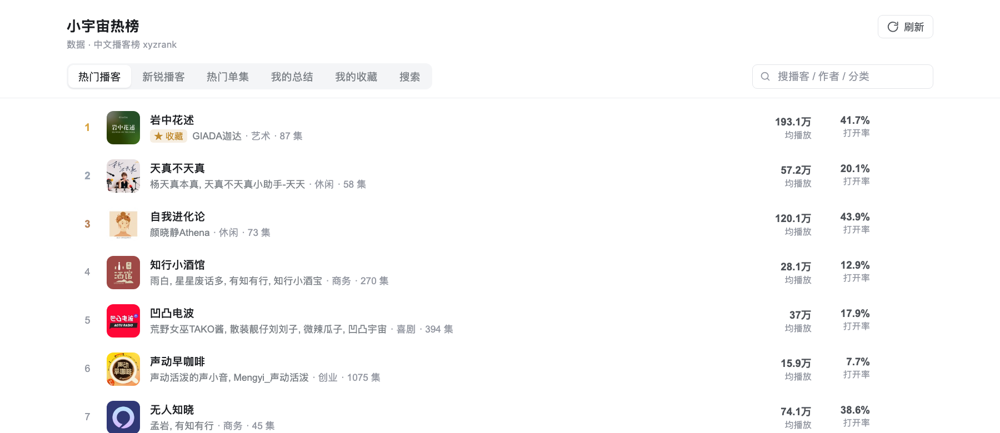

# @lim324/dsh-xiaoyuzhou-hot · 小宇宙热榜

DSH Web GUI 插件:左侧边栏多一个榜单入口,点开在主列显示**小宇宙热门播客 / 新锐播客 / 热门单集**。

- 播客行:**原地切到该播客的频道,列出分集**(不再跳浏览器)。
- 单集行:**点一下新开一个 DSH 会话,并把"总结这一集"的任务预填进输入框**,回车即开跑;行尾的 ↗ 才是在小宇宙打开。
- 总结过的单集会被记下来:列表里带 ✓、频道页显示「已总结 N」,并有 tab「我的总结」按时间倒序列出全部记录。
- 播客频道可以收藏(频道页右上角 `☆ 收藏`),收藏的频道在 tab「我的收藏」里,点一下直接进频道,不用每次回榜单里找。



## 它解决什么

小宇宙没有公开 API,榜单只在 App 里(接口要登录态 token,网页端也没有列表页)。这个插件把第三方「中文播客榜」(xyzrank)的公开 JSON 接进 GUI,顺手做缓存与降级,让"今天有什么在涨"变成一眼可见。

真正的目的是把"看到一集 → 总结它"这段路缩短到一次点击:不用复制标题、不用贴链接、不用重述流程。

## 怎么知道哪些读过(已读记录)

点「总结」的那一刻,插件往宿主写一条记录,存在本机:

```
$DSH_HOME/xiaoyuzhou-hot/library.json     # 默认 ~/.dsh/xiaoyuzhou-hot/library.json
{ "version": 1, "items": [ { key, title, podcast, url, podcastUrl, at } ] }
```

- 键优先用单集 id(`eid`),没有就退化到链接;
- 写入用 tmp + rename,不会写坏;每次落盘前把上一版复制成 `library.json.bak`,主文件丢失/损坏时自动从备份读回;
- 写入有 150ms 合并窗口,插件卸载/热重载时立即落盘(不等窗口);`MAX_LIBRARY` 2000 条封顶,超出丢最旧;
- **测试隔离**:`test-host.mjs` / `test-client.mjs` 会把 `DSH_HOME` 指到临时目录,绝不碰真实记录;
- 面板里:**行首 ✓ + 「已总结」小标签**、频道页头部「已总结 N」、`我的总结` tab(可按关键词过滤,点 × 取消标记);
- 会话侧:预填 prompt 的第一行就是 `总结《播客》单集标题`,而 DSH 的默认标题 provider 从首个 prompt 生成标题,所以左侧会话列表里能直接认出是哪一集。

### 关联到那次会话

`我的总结` 里的条目可以点了直接跳回总结会话:

```
点单集 → sessions.list 快照 S0 → startSession() → 每 250ms 看快照
       → 恰好多出 1 个会话(sessionId) → POST /x-hot/library { key, sessionId }
```

- `startSession()` 不返回 id,所以用"前后快照差"来认定:只多出一个才算,多出多个(并发操作)就放弃关联——宁可没链接,也不链错;
- 6 秒内没等到就放弃(比如 DSH 复用了空白会话,不会新建);
- 有 `sessionId` 的行:点击 → `uiWorkspace.openSession(id)` 跳回那次对话,右侧另有 ↗ 去小宇宙;没有的行点击仍然是打开小宇宙。

### 记录丢了/没关联会话怎么补救

面板里:`我的总结` → 右下角 **重新关联会话** 按钮,点完给一行反馈(`匹配 N · 新关联 M`)。

命令行也行(离线可用,不需要 dsh 在跑):

```bash
node scripts/relink-sessions.mjs --dry-run   # 只匹配,不改库
node scripts/relink-sessions.mjs             # 回写 sessionId(走插件接口)
```

接口:`POST /x-hot/library/relink` → `{ scanned, matched, linked, items }`。

它扫 `$DSH_HOME/sessions/*/session-*/session.v4.jsonl.zstd`,找以「总结《播客》单集标题」开头的用户消息,按标题和 `library.json` 对齐后调用 `POST /x-hot/library` 补 `sessionId`。

两个坑写在这里免得再踩:

- 会话文件是**多段 zstd 拼接**,Node 的 `zstdDecompressSync` 只解第一段(约 200 字节),必须用 `zstd -dc`;
- 会话里的中文是 `\uXXXX` 转义,**不能直接对原文 grep 中文**,要逐行 `JSON.parse`。
还有一个坑:**SessionId 是带 `session-` 前缀的目录名**(`session-<uuid>`),不是裸 uuid——剥掉前缀的话 `uiWorkspace.openSession` 会抛错,表现为"点了没反应/跳去浏览器"。

### 路由

| 路由 | 说明 |
|---|---|
| `GET /x-hot/library` | 读全部记录(按时间倒序) |
| `POST /x-hot/library` | 记一条(JSON: `key/title/podcast/url/podcastUrl/sessionId`);**局部更新会与已有条目合并**,只传 `{key, sessionId}` 不会冲掉标题 |
| `DELETE /x-hot/library?key=...` | 取消一条 |

## 收藏(频道级)

存在同一个目录下的 `favorites.json`(和已读记录共用一套存储类,只是字段不同):

```
$DSH_HOME/xiaoyuzhou-hot/favorites.json
{ "version": 1, "items": [ { key: <播客 id>, title, author, genre, url, appleId, logo, at } ] }
```

- 频道页右上角 `☆ 收藏` / `★ 已收藏` 切换;
- 榜单里的播客行会带一个小小的 `★ 收藏` 标记,一眼看出哪些已经收过;
- `我的收藏` tab:点行 → 原地进频道;`×` → 取消收藏;支持关键词过滤。

### 路由

| 路由 | 说明 |
|---|---|
| `GET /x-hot/favorites` | 收藏列表(按收藏时间倒序) |
| `POST /x-hot/favorites` | 收藏(JSON: `key/title/author/genre/url/appleId/logo`) |
| `DELETE /x-hot/favorites?id=<播客 id>` | 取消收藏 |

## 频道页从哪拿分集

小宇宙网页只渲染最新 15 集,没有分页接口;App API 要登录态。所以分集走播客自己的 RSS:

```
小宇宙播客 id / Apple id   →  iTunes lookup 拿 feedUrl   →  RSS 全量分集
   (来自 xyzrank 的 links.apple)      ↓ 拿不到 RSS
                                小宇宙播客页 SSR(最新 15 集)+ 提示"完整历史去小宇宙"
```

小宇宙托管的节目,feed 就在 `feed.xyzfm.space`(如《岩中花述》87 集、《知行小酒馆》270 集),条数与该播客的单集总数一致,标题/日期/时长/音频直链都能拿到。

解析用正则完成,不引第三方 XML 库:支持 CDATA、`&amp;` 等实体、`itunes:duration` 的 `01:51:36` / `6660` 两种写法。

### 路由

| 路由 | 说明 |
|---|---|
| `GET /x-hot/channel?id=<24位小宇宙播客id>&apple=<Apple播客id>&limit=1..300` | 频道分集;`source=rss` 或 `ssr` |

## 点击单集之后发生什么

```js
uiWorkspace.startSession(undefined, { prompt, clearPreviousDraft: true })
```

- `sessionScope` 走 `ctx.inject(['uiWorkspace'])` 拿,晚于 `slots` 就绪也不会卡住面板注册;
- 没有 `uiWorkspace`(非 Web 组合、或服务未就绪)时退化成打开小宇宙网页,不会静默失败;
- 预填的 prompt 带标题、播客名、发布日期、时长、单集页链接;**从频道页点进来的还带音频直链**,流程会相应改成"页面打不开就直接下音频转写";
- prompt 里写明流程(读 shownotes → mlx-whisper 转写 → 结论/要点/金句/判断),新会话不需要再问一遍"用什么工具";
- `clearPreviousDraft: true` 是刻意的:保证这次的任务真的落进输入框,代价是会覆盖被复用空白会话里的旧草稿。

## 数据与实现

```
浏览器  ──GET /x-hot/list?kind=podcasts&limit=100──▶  宿主插件(dsh-host-webserver 路由)
                                                          │ 5 分钟内存缓存 + 并发去重
                                                          ▼
                                               https://xyzrank.com/api/podcasts
```

- 为什么要有宿主半:xyzrank 不回 `Access-Control-Allow-Origin`,浏览器直连会被 CORS 拦掉;由宿主代理后是同源请求。
- 降级:上游挂掉时返回上次缓存并标 `stale`,面板不会空屏;仍失败则显示错误与「重试」。
- 脏数据:上游偶发 `openRate > 100%`,面板显示 `—` 而不是误导性数字。

### 路由

| 路由 | 说明 |
|---|---|
| `GET /x-hot/list?kind=podcasts\|new\|episodes\|new-episodes&limit=1..100&offset=0` | 榜单数据(归一化后的 JSON,播客条目带 `appleId`) |
| `GET /x-hot/health` | 存活探针 |

返回:

```json
{ "ok": true, "kind": "podcasts", "items": [{ "rank": 1, "title": "岩中花述", "author": "GIADA迦达",
  "genre": "艺术", "episodes": 87, "avgPlay": 1919952, "openRate": 0.416,
  "url": "https://www.xiaoyuzhoufm.com/podcast/625635587bfca4e73e990703", "logo": "..." }],
  "total": 8176, "cached": true, "fetchedAt": 1762... }
```

### 客户端 slot

```js
// 侧栏图标:list id 与 main panel 的 key 必须一致
ctx.slots.register({ name: 'sidebar.panellist', id: 'xyzrank-hot', order: 16, label: '小宇宙热榜' }, HotIcon)
ctx.slots.register({ name: 'main', key: 'xyzrank-hot' }, HotPanel)
```

样式全部用 DSH 的 `--dsw-*` 令牌(`--dsw-alias-bg-base` / `label-*` / `border-l1` / `radius-*`),浅色深色自动跟随,不写死颜色。

## 安装 / 卸载

```bash
# 装进 web profile(link 方式,改源码后重新 build 即可)
dsh plugin --profile web add link:$HOME/.dsh-0.2.1-rc.2/plugins/xiaoyuzhou-hot

# 再把 "@lim324/dsh-xiaoyuzhou-hot" 追加进 ~/.dsh/profiles/web/package.json 的 dsh.profile.bundles
# 然后刷新页面;宿主半会随 profile 热重载,客户端半通常需要刷新一次(必要时重启 dsh web)
```

卸载:

```bash
dsh plugin --profile web remove @lim324/dsh-xiaoyuzhou-hot
# 并从 dsh.profile.bundles 里删掉
```

## 开发

```bash
node build.mjs          # 产出 lib/index.js(宿主)+ lib/client.js(__ModuleLoader__ 包)
node test-host.mjs      # 路由 + 缓存 + 降级(打真实上游)
node test-client.mjs    # jsdom 里真实 mount:渲染 100 行 + 断言"点单集→startSession(预填 prompt)"
```

`test-client.mjs` 会顺带产出 `preview.html` 与 `preview-episodes.html`,可以直接用浏览器打开看效果,不依赖 DSH。

## 已知限制

- 榜单口径来自第三方 xyzrank(约 8k 档节目),不是小宇宙官方榜;更新有滞后。
- 上游没有分页游标,`limit` 最大 100;面板只展示前 100 名。
- 只读:不做订阅、不做播放;点单集只是开一场新会话并预填任务,真正发不发由你决定。
- 频道页依赖 RSS:播客没有 Apple 链接(或 RSS 抓不到)时退化到最新 15 集,这一点会在页脚标出来。
- 封面图来自上游(部分是 Apple 的 CDN),离线时显示占位块。
